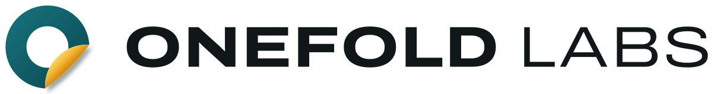

# ONEFOLD LABS brand

Logo, colours, type and the rules for using them, for every ONEFOLD LABS project: StudioCraft, CodeCraft, TermCraft, GitCraft, DataCraft, CloudCraft and IssueCraft.

<p>
  <picture>
    <source media="(prefers-color-scheme: dark)" srcset="logos/onefold-lockup-on-dark.svg">
    
  </picture>
</p>

## What is here

| Folder | Contents |
|---|---|
| [`logos/`](logos/) | The mark, lockups and avatar as SVG and PNG. See [`logos/README.md`](logos/README.md) for which file goes where. |
| [`tokens/`](tokens/) | `tokens.json` (colours for light and dark, type scale, spacing, radii) and the compiled `tokens.css`. |
| [`apps/`](apps/) | App icons (`icon.svg`, `icon-small.svg`) and `palette.json` with interface, semantic and domain colours for every app, plus `sheet.png`. |
| [`tools/`](tools/) | `make_logo.py` computes every logo; `make_app_icons.py` computes the app icons and colours; `build.sh` rebuilds logos, PNGs and `tokens.css`; `comfyui/` holds the exploration rounds. |
| [`concepts/`](concepts/) | The Krea-2 drafts the mark was found in, with prompts and seeds. Reference only. |

Rebuild everything after changing geometry, colours or tokens:

```sh
tools/build.sh   # needs python3 + fonttools, rsvg-convert, curl
```

# Brand book

ONEFOLD LABS is the umbrella for a family of open desktop tools: StudioCraft, CodeCraft, TermCraft, GitCraft, DataCraft, CloudCraft, IssueCraft. Each app does one thing thoroughly, runs locally, needs no account and is open source. The brand says the same: **one sheet, one fold.** A good tool needs no more moves than that.

## The mark

The letter O, folded once. A petrol ring has its lower-right edge peeled back along a diagonal fold; the flap shows its `saffron` back, catches the light and casts a soft shadow onto the ring. The mark was found in three rounds of Krea-2 on a local ComfyUI (`concepts/`: flat drafts, drafts with depth, then image-to-image with a larger flap) and redrawn as exact vector geometry.

- Geometry on the 512 grid: outer radius 226, counter radius 113, fold line 151 from the centre at 45° towards the lower right. The flap is the folded cap mirrored across that line, its fold edge bowed outward by 16. Never trace, distort, rotate, mirror or recolour it. Take the files from `logos/`.
- **With depth** (`onefold-mark.svg`, `onefold-lockup.svg`, the avatar): the primary mark from 32 px up, for the website, README headers, social images and app About dialogs. On dark grounds use the `-on-dark` versions; their ring is lighter and the shadow stronger.
- **Flat** (`onefold-mark-flat.svg`, `-ink`, `-white`): below 32 px, for favicons, print in spot colours, embossing and anywhere effects are unavailable. A narrow gap in the ground colour separates the flap from the ring, so the fold reads even in one colour.
- The gradients and the shadow belong to the mark only. Interface surfaces stay flat (see Colour).
- Clear space: keep at least a quarter of the mark's diameter free around it. Minimum size: 16 px for the flat mark, 32 px for the mark with depth, 120 px wide for the horizontal lockup.
- The wordmark is Archivo (width 125 %) converted to outlines: **ONEFOLD** in extra bold, **LABS** light. Never re-set it in another typeface.
- GitHub organisation and social avatars: `onefold-avatar-1024.png` (mark with depth on `paper`).

## The app family

Every ONEFOLD app is **a disc in its own colour** with a cut-out motif that shows its job. StudioCraft sets the pattern: a wine-red disc with a decaying wave cut out of it ([`assets/app-icon`](https://github.com/ONEFOLD-LABS/StudioCraft/tree/main/assets/app-icon) in the StudioCraft repository). The other apps follow the same grid:

- 512 viewBox, disc radius 226, transparent ground, no tile.
- Gradient from top left (one step lighter) to bottom right (one step darker) around the app colour `app-<name>`.
- The motif is a real hole in the disc, computed geometry, one single shape. It must stay open from 32 px; 16–32 px get a simplified version.
- Inside the app, its colour is the sparing accent; the interface stays neutral. The ONEFOLD mark appears in an app only in the About dialog, as `onefold-mark-ink.svg` or `-white.svg` at 16–24 px with the line “A tool by ONEFOLD LABS”.
- Every `app-<name>` colour holds at least 4.5:1 against white. The icons, the interface accents for both themes and the colours for each app's own data are computed from these tokens by `tools/make_app_icons.py`; see [`apps/`](apps/).

## Colour

Neutral first, brand sparingly. `paper` carries the page, `surface` the cards, `ink` the text. `petrol` is the one brand colour for links, primary buttons and the mark. `saffron` is the back of the fold: highlights, a “New” badge, the flap. At most one `saffron` area per view.

- Text on `petrol` is always `on-petrol`, on `saffron` always `on-saffron`. Never `saffron` as text on a light ground.
- `line` is decoration only. Borders of inputs and buttons use `ink-muted` so they hold 3:1.
- Focus: 2px solid ring in `focus`, 2px offset. Petrol in light, saffron in dark.
- No gradients or shadows on interface surfaces. Exceptions: the ONEFOLD mark, app icons, and floating menus (shadow only).

## Type

One family, two widths: **Archivo** for everything you read, **JetBrains Mono** for everything you type. Both are free on Google Fonts (OFL).

- `display-xl` and `display` set Archivo with `font-stretch: 125%`, in caps or short product names. That echoes the wordmark without copying it.
- `title` and `heading` in normal width; `body` at 16/26 with lines up to 68 characters.
- Commands, paths and versions in `code` and `mono-label`: `cargo xtask ci`, `v0.7.0 · x86_64`.
- Load Google Fonts with `family=Archivo:wdth,wght@62..125,100..900&family=JetBrains+Mono:wght@400;500`.

## Space and shape

Spacing on a 4 px grid: `space-4` inside cards, `space-6` between groups, `space-12` between website sections. Corners: `radius-md` for buttons and cards, `radius-lg` for screenshots, `radius-disc` for everything round. The circle is the brand's basic shape: wherever a shape is needed (avatar, tag, status dot), it is round.

## Principles

Every ONEFOLD app shares these, and the brand never promises more than they hold:

- **Local first.** Works without a network; cloud features are optional.
- **No account.** Nothing to sign up for to use the app.
- **Open source.** Permissive licences only (MIT, Apache-2.0, BSD and the like), credited in `NOTICE`.
- **Clean room.** Built from observed behaviour and public specifications, never from other products' code, icons, sounds or wording. Other products and other app families are not named in UI, docs or marketing.
- **Native.** Pure Rust, one interface for Linux, Windows, macOS, FreeBSD and the web.

## Language

- ONEFOLD LABS speaks English first: website, organisation README, release notes, commits and code. App interfaces ship in English and German (StudioCraft keys its strings in German and translates through `en.tsv`).
- Short, factual, direct. Address the reader as “you”. No exclamation marks, no emoji in UI or docs.
- Name things the way users know them: “track”, “mixer”, “branch”, not internal type names.
- The values every project shares, verbatim: “Local first. No account. Open source.”
- The name is always in caps: ONEFOLD LABS. Apps in camel case: StudioCraft, never “Studio Craft” or “STUDIOCRAFT”.

## Iconography

The apps draw their icons as vectors in code (StudioCraft: `crates/ui/src/icons.rs`), single colour, 1.5 px stroke on 16 and 20 px grids, tinted with `ink` or `ink-muted`. No icon fonts, no emoji. There is no shared icon set yet; until there is, every app follows this stroke and grid.
