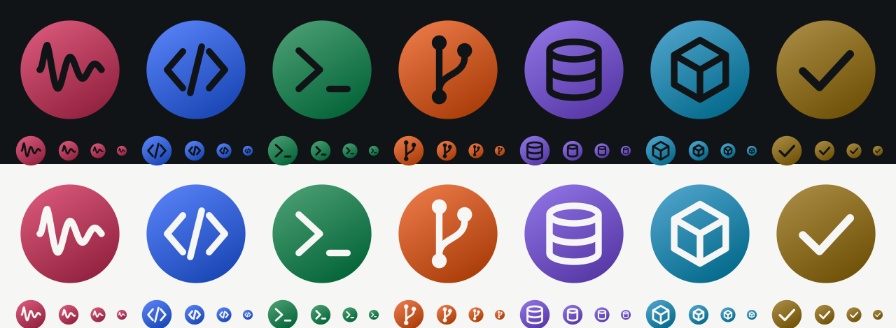

# App icons and app colours

Icons and colour sets for every ONEFOLD LABS app, computed by `tools/make_app_icons.py` from
`tokens/tokens.json`. They follow "The app family" in the brand book; nothing is drawn by hand
or traced.

```sh
uv run --with shapely python tools/make_app_icons.py   # rewrites apps/<app>/*.svg and apps/palette.json
```



## Icons

| App | Motif | Colour (`app-<name>`) |
|---|---|---|
| StudioCraft | Decay: a struck tone that rises and rings out (the shipped icon, unchanged) | `#9e2343` wine |
| CodeCraft | Brackets: `</>` | `#2d5bd2` cobalt |
| TermCraft | Prompt: a chevron and a waiting cursor | `#1d7a4c` fir green |
| GitCraft | Branch: a line of history, a branch leaving it, three commits | `#c4501d` brick |
| DataCraft | Store: a database cylinder | `#6a4cc0` violet |
| CloudCraft | Block: an isometric block, the unit of infrastructure | `#167fa6` sky blue |
| IssueCraft | Done: a check mark | `#86650f` ochre |

Per app: `icon.svg` (30 px strokes, from 48 px) and `icon-small.svg` (44 px strokes, simplified
where needed, 16–32 px). Disc radius 226 on the 512 grid, gradient from the app colour one step
lighter (top left) to one step darker (bottom right), motif cut out as one real hole. The app
repositories copy these into `assets/app-icon/` and render the platform sizes from them.

The Branch motif is a common way to show a branch; it is drawn from scratch here, not taken from
an icon set.

## Colours

`palette.json` holds, per app and theme:

- `accent`, `on_accent`, `accent_strong` (hover, pressed), `accent_tint` (selection, callouts).
  Light theme: the app colour with white text. Dark theme: a lighter accent with near-black
  text (`on-petrol`), the same pattern as `petrol`.
- `domain`: colours for the app's own data, for example GitCraft's file states, TermCraft's
  ANSI colours 1–6, CodeCraft's syntax, DataCraft's data types and transaction state,
  CloudCraft's environments (production, staging, development, local) and resource states,
  IssueCraft's types and priorities.

And for all apps, `semantic`: success, warning, danger, info, neutral.

Checks, recomputed on every run:

- Every text colour (semantic, domain) holds at least 4.6:1 on `paper`, `surface` and
  `surface-sunken` of its theme.
- `on_accent` on `accent` at least 4.5:1; `accent` against the grounds at least 3:1.

Not in the tokens yet: the semantic colours and the per-app UI and domain colours. Once they are
settled they can move into `tokens.json`.
